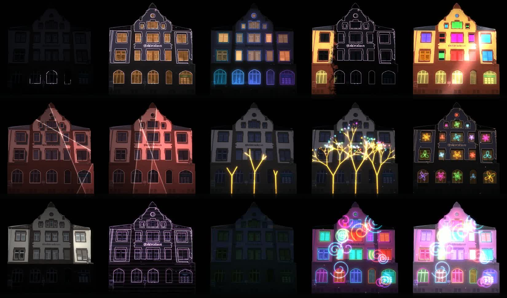

# Buchdruckerei – Projection Mapping

Eine 60-Sekunden-Mapping-Show für die Fassade der Buchdruckerei, komplett prozedural in Python erzeugt (OpenCV + NumPy + ffmpeg).



## Inhalt

| Ordner | Was |
|---|---|
| `media/preview_1080p.mp4` | Vorschau 1920×1080 mit Sound – so sieht es auf dem Gebäude aus |
| `media/content_resolume_942x1000.mp4` | Reiner Projektor-Content, deckungsgleich mit `src/facade.jpg` – für Resolume Advanced Output |
| `keyframes/` | Schlüsselbilder der Szenen (Start-/Endbilder für KI-Clips, z. B. Higgsfield / Kling) |
| `docs/masks.jpg` | Masken: Putz, Sandstein, Dach, Glas, Fensterrahmen + Linienzeichnung |
| `src/render.py` | Masken, Szenen und Renderer |
| `src/audio.py` | Soundtrack (100 BPM, synthetisch) |

## v3 – 2-Minuten-3D-Show in 4K (aktuell)

`media/Buchdruckerei_4K_Vorschau_1080p.mp4` – Vorschau. Die 4K-Datei (3840×2160) und der Resolume-Content (1506×1600) sind zu groß für GitHub und liegen lokal.
Echtes 3D per Heightfield-Raytracing (Perspektive, Seitenflächen, Schlagschatten, AO, Glanz). Code: `src/v3_4k/`.

| Zeit | Szene |
|---|---|
| 0–7 s | Linien zeichnen die Architektur |
| 6–14 s | Streiflicht mit echten Schatten, Relief wächst |
| 14–22 s | Sandsteinblöcke fahren in Wellen heraus / tauchen ein |
| 22–30 s | Fensterkästen fahren vor, Fenster werden tiefe warme Räume |
| 30–40 s | **Ethnik_84** (s/w, ohne Flackern) hinter der Fassade, erst durch die Fenster, dann als Portal |
| 40–48 s | Fassade zerbricht → **Polygon-Tunnel** als 3D-Relief dahinter |
| 48–55 s | Flüssige Steinwellen mit Glanz |
| 55–65 s | **Ethnik_07** als flaches, gut lesbares Relief, tiefer gesetzt |
| 65–75 s | **Ethnik_101** auf einem Bildschirm-Monolith, der aus der Fassade fährt und sich dreht |
| 75–87 s | Fassade teilt sich wie ein Tempeltor → **Ethnik_124** nah am Original |
| 87–95 s | Kühles Mondlicht-Streiflicht |
| 95–108 s | Warmes Finale, Giebel springt zweimal heraus |
| 108–120 s | Linien-Outro, Blackout |

## 3D-Version mit Higgsfield (Kling 3.0)

`media/Buchdruckerei_3D_Mapping_Higgsfield.mp4` – 60 s: Intro → 5 KI-Clips → Neon-Outro.
Jeder Clip interpoliert per Start-/Endbild zwischen zwei Keyframes aus `keyframes/` (über raw.githubusercontent.com an Higgsfield übergeben), dadurch sind die Übergänge nahtlos.

| Zeit | Clip | 3D-Moment |
|---|---|---|
| 0–5 s | Intro | Fassade blendet aus dem Dunkeln auf |
| 5–15 s | clip1 | Linien zeichnen die Architektur, Neon-Spitzbögen |
| 15–25 s | clip2 | Fensterläden klappen räumlich aus der Wand, Farbwelle |
| 25–35 s | clip3 | Fassade beult sich aus und faltet sich in Koralle |
| 35–45 s | clip4 | Wand zerfällt ins Dunkle, Goldbäume wachsen heraus |
| 45–55 s | clip5 | Bäume zerfallen zu Partikeln, Fassade wölbt sich, Neon-Finale |
| 55–60 s | Outro | Schlusslicht, Blackout |

Einzelclips: `media/higgsfield_clips/` (1280×720, 24 fps).

## Ablauf (prozedurale Version)

| Zeit | Szene |
|---|---|
| 0–6 s | Linienzeichnung baut die Fassade auf, warme Fenster |
| 6–13 s | Neon-Spitzbögen, flackern von der Mitte nach außen an |
| 13–20 s | Pinselwelle: Ocker/Terrakotta, Fenster klappen bunt um, Lichtstreif |
| 20–27 s | Korallenfassade mit wandernden Lichtfalten und Schlagschatten |
| 27–35 s | Goldene Bäume wachsen, bunte Kugeln, Funkeln |
| 35–41 s | Rotierende Ornamente in jedem Fenster |
| 41–47 s | Gebäudeteile blitzen auf, rosa Wireframe |
| 47–50 s | Glitch |
| 50–60 s | Neon-Finale mit Spiralen, Schlusslicht, Blackout |

## Selbst rendern

```bash
pip install opencv-python numpy
cd src
python audio.py                      # -> sound.wav
python render.py stills 9,18,33,55   # Testbilder
python render.py video 0 1800 all    # -> prev_all.mp4 + cont_all.mp4
ffmpeg -i prev_all.mp4 -i sound.wav -c:v copy -c:a aac -shortest preview.mp4
```

## In Resolume

1. `content_resolume_942x1000.mp4` als Clip laden.
2. Im Advanced Output `facade.jpg` als Hintergrund/Referenz nehmen und den Slice per Eckpunkten (oder Mesh-Warp) auf das reale Gebäude ziehen.
3. Da Content und Foto deckungsgleich sind, sitzen Fenster, Bögen und Rahmen automatisch richtig.
